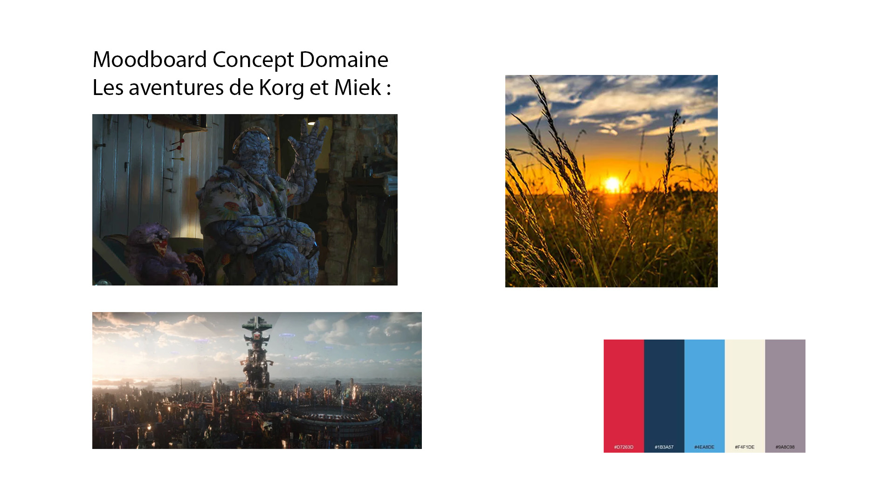

# Les aventures de Korg et Miek

Projet conçu en équipe avec : Wilsen, Viet

## Le concept et l'audience

- Une phrase (logline) : Korg et Miek se font capturer et veulent revenir chez eux.
- Le public cible : 18+
- La franchise d'origine : Thor Ragnarok

## L'intrigue

- Le début : Sur une autre planète vie tranquille sur une ferme
- Le milieu : Politicien de Sakaar offre protection millitaire en échange des ressources de la planète
- Le revirement (plot twist) : éxecute sa famille et Réduit la population en esclavage
- La fin : Envoie Korg et Miek sur la planète Sakaar comme esclave gladiateur

## Le personnage principal

- Description (physique et psychologique) : Korg
- Son désir (ce qu'il veut) : Protéger sa famille, son ami Miek et revenir chez lui
- Son besoin (ce qu'il lui faut) : Gagner les jeux et/ou s'évader
- Son évolution : Début: pacifiste, Fin: Combatant

## L'univers

- Où et quand se passe l'histoire : 2 ans avant Thor Ragnarok
- Un élément de folklore qui rend l'univers vivant : La nourriture cultivé sur leur planète d'origine est composé de pierres précieuses.

## La direction cinématographique

- La palette de couleurs : Sur le Moodboard
- L'éclairage : Naturel, Cosmic
- Le rythme du montage : Coupure rapide entre grand plan, plan rapproché
- Un moodboard (3 à 5 images de référence) :

